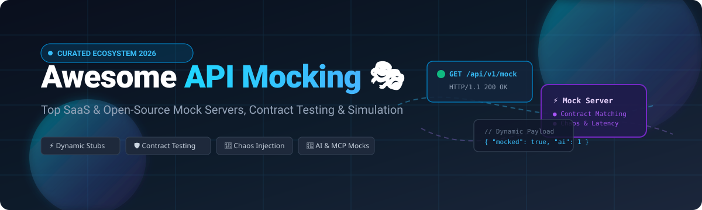

# 🎭 Awesome API Mocking

> **A curated, comprehensive catalog of enterprise SaaS platforms and battle-tested open-source API mocking tools, mock servers, service virtualization solutions, and contract-first simulation engines.**

  
  
  
  
  
  

*Focused on Request Matching, Stateful Simulation, Contract-First Workflows & Chaos Injection*  

**Last updated: October 2026** ⚡

---

This repository is an SEO-optimized, industry-referenced guide tracking the best **API Mocking SaaS platforms** and **open-source mock servers**. Whether you need to simulate complex microservices before backend APIs exist, conduct chaos and latency injection, perform contract testing with OpenAPI/GraphQL/gRPC, or integrate MCP (Model Context Protocol) endpoints for AI agents, this list covers the entire modern API simulation landscape.

---

## 📑 Table of Contents

- [📊 Sector Overview & Market Dynamics](#-sector-overview--market-dynamics)
- [☁️ SaaS & Hosted API Mocking Platforms](#️-saas--hosted-api-mocking-platforms)
- [💻 Open-Source API Mocking & Simulation Tools](#-open-source-api-mocking--simulation-tools)
- [🛠️ Key Evaluation Criteria: How to Choose](#️-key-evaluation-criteria-how-to-choose)
- [🤝 How to Contribute](#-how-to-contribute)
- [💖 Support & Sponsorship](#-support--sponsorship)
- [📈 Star History](#-star-history)
- [⚖️ Disclaimer & Security Best Practices](#️-disclaimer--security-best-practices)

---

## 📊 Sector Overview & Market Dynamics

The global **API simulation and service virtualization market** is currently valued between **$0.8B and $1.2B**, expanding rapidly at a **14%–17% CAGR** toward an estimated **$2.3B–$3.8B** over the next decade. 

- **Enterprise Layer (Moderately Concentrated)**: Dominated by established software quality and service virtualization powerhouses like SmartBear (ReadyAPI), Broadcom, and legacy virtualization suites serving large financial, telecom, and healthcare enterprises where regulatory compliance, multi-protocol virtualization (REST, SOAP, JMS, JDBC), and high SLA guarantees are mandatory.
- **Developer & Cloud Tier (Highly Fragmented)**: Characterized by explosive competition among developer-first SaaS suites (Postman, WireMock Cloud, Beeceptor, Apidog) and vibrant open-source projects (MSW, Mockoon, WireMock OSS, Microcks, JSON Server) enabling lightweight local mocks, Git-native mock stubs, and automated CI/CD integration.

---

## ☁️ SaaS & Hosted API Mocking Platforms

Below is a breakdown of top commercial and managed API mocking platforms, sorted descending by **Company Scale / Valuation**:

| Platform | Company Size / Valuation 🏢 | Pricing (Starting Tier) 💳 | Free Tier Limits 🎁 | Key Architectural Highlights 🔍 |
| :--- | :--- | :--- | :--- | :--- |
| **[Postman Mock Server](https://www.postman.com/)** | **$5.6B valuation** (~$313M ARR) | **$9 / user / month** (Solo tier, billed annually) | **Free forever**: 1 user, multi-protocol client, unlimited local/cloud mock servers (usage subject to standard account call limits) | Cloud and local mock servers from collection examples. Desktop Local Mocks let developers mock directly against local Git branches. |
| **[ReadyAPI Virtualization](https://smartbear.com/product/ready-api/)** (SmartBear) | **>$1.2B valuation** (~$500M+ revenue) | **$1,069 / year** (~$89/mo, ReadyAPI Test/Virtualization fixed license) | **14-day free trial**: Full Pro access to Test, Performance, and Virtualization modules (no permanent free tier) | Heavyweight enterprise service virtualization across REST, SOAP, JMS, JDBC, and event queues for compliance-heavy systems. |
| **[WireMock Cloud](https://wiremock.io/)** *(formerly MockLab)* | **$6.5M funding** (~$0.6M–$1.2M ARR) | **Custom-quoted / Enterprise** (Inquire for paid tiers) | **Free forever**: 1 user, 1,000 mock API calls/calendar month, 3 mock APIs, 10 req/s rate limit | Managed WireMock with whole-API chaos injection (latency/error bursts across all endpoints), stateful scenarios, and team ACLs. |
| **[Apidog](https://apidog.com/)** | **Bootstrapped / Private** (Early stage, undisclosed) | **$9 / user / month** (Basic tier, billed annually) | **Free forever**: Up to 4 team members, 5 projects, unlimited mock runs and visual API design | All-in-one API workspace uniting API specification design, automated regression testing, smart mock engines, and doc generation. |
| **[Beeceptor](https://beeceptor.com/)** | **Bootstrapped / Private** (<20 employees, undisclosed) | **$10 / month** (Individual tier; Team at $25/mo) | **Free forever**: 50 requests/day, 3 mock rules, public endpoint | Zero-configuration instant mock server with AI-assisted contextual mock generators and outbound HTTP forward proxy inspection. |

---

## 💻 Open-Source API Mocking & Simulation Tools

Ranked and sorted in descending order by **GitHub_Stars_Count ⭐**:

### 1. **[Hoppscotch](https://github.com/hoppscotch/hoppscotch)**

- **License**: MIT 
- **Language**: TypeScript / Vue
- **Description**: Open-source, lightweight, privacy-focused API development ecosystem and web client with built-in mock server features, environment synchronization, and multi-protocol inspection (REST, GraphQL, WebSocket, SSE).
- **Best for**: Teams seeking a lightweight, self-hostable Postman alternative with cloud and local mocking capabilities.

### 2. **[JSON Server](https://github.com/typicode/json-server)**

- **License**: MIT
- **Language**: JavaScript / TypeScript
- **Description**: Get a full fake REST API with zero coding in less than 30 seconds. Supports route filtering, sorting, pagination, and file-persisted JSON state changes automatically on `POST`, `PUT`, `PATCH`, and `DELETE`.
- **Best for**: Rapid frontend prototyping, unit testing scripts, and zero-configuration backend emulation.

### 3. **[Swagger UI](https://github.com/swagger-api/swagger-ui)**

- **License**: Apache-2.0
- **Language**: JavaScript
- **Description**: Visual documentation rendering for OpenAPI (OAS 3.0 / Swagger) specs with interactive "Try it out" capabilities that can pair with live mock backends or static response stubs.
- **Best for**: Interactive API documentation and spec-driven visual validation.

### 4. **[OpenAPI Generator](https://github.com/OpenAPITools/openapi-generator)**

- **License**: Apache-2.0
- **Language**: Java
- **Description**: Generates API client SDKs, server stubs (Node.js, Go, Spring, Flask, etc.), and mock boilerplate directly from OpenAPI 2.0/3.0 specifications across 50+ languages and frameworks.
- **Best for**: Contract-first development and automated generation of mock server implementations.

### 5. **[Mock Service Worker (MSW)](https://github.com/mswjs/msw)**

- **License**: MIT
- **Language**: TypeScript
- **Description**: Seamless client-side and server-side API mocking for browser and Node.js using Service Worker API. Intercepts requests at the network level without altering application code or stubbing modules.
- **Best for**: Modern web applications (React, Vue, Next.js), integration testing, and Jest/Vitest/Playwright suites.

### 6. **[Nock](https://github.com/nock/nock)**

- **License**: MIT
- **Language**: TypeScript / JavaScript
- **Description**: HTTP server mocking and expectations library for Node.js. Intercepts outbound HTTP/HTTPS requests generated by `http.request` or libraries like Axios and Fetch, matching headers, queries, and bodies.
- **Best for**: Node.js automated unit testing and isolated service test runners.

### 7. **[Mockoon](https://github.com/mockoon/mockoon)**

- **License**: MIT
- **Language**: TypeScript
- **Description**: The easiest local-first mock API generator. Provides a clean desktop GUI for macOS, Linux, and Windows, plus a headless CLI (`@mockoon/cli`) and official GitHub Actions for CI/CD pipelines. Zero accounts or telemetry required.
- **Best for**: Local offline development, cross-platform engineering teams, and fast microservice sandboxing.

### 8. **[WireMock (OSS)](https://github.com/wiremock/wiremock)**

- **License**: Apache-2.0
- **Language**: Java
- **Description**: The enterprise standard for flexible API simulation. Runs as a standalone server, Docker container, or embedded Testcontainers module. Features rich request matching, Handlebars response templating, record/playback proxying, and fault simulation.
- **Best for**: Robust CI/CD pipelines, JVM ecosystems, microservices contract testing, and advanced chaos simulation.

### 9. **[Mirage JS](https://github.com/miragejs/miragejs)**

- **License**: MIT
- **Language**: JavaScript
- **Description**: Client-side API mocking library with an in-memory database and relationships engine. Lets frontend developers build full working prototypes that mirror complex relational backend endpoints.
- **Best for**: Single-page application prototyping and frontend component testing.

### 10. **[Stoplight Prism](https://github.com/stoplightio/prism)**

- **License**: Apache-2.0
- **Language**: TypeScript
- **Description**: Spec-first HTTP mock and validation server. Feeds directly from OpenAPI v2/v3 documents to produce realistic dynamic responses while validating that inbound requests strictly adhere to the contract schema.
- **Best for**: Design-first teams, contract enforcement, and catching payload mismatches early in the pipeline.

### 11. **[MockServer](https://github.com/mock-server/mockserver)**

- **License**: Apache-2.0
- **Language**: Java
- **Description**: Enterprise HTTP/HTTPS mock server with interactive breakpoints, proxy recording, OpenAPI matching, and dynamic chaos profiles. Includes multi-language client bindings for Python, Node, Go, .NET, Ruby, and Rust.
- **Best for**: Chaos engineering, multi-protocol mocking (WebSocket, gRPC, SSE), and enterprise integration test suites.

### 12. **[Microcks](https://github.com/microcks/microcks)**

- **License**: Apache-2.0 (CNCF Sandbox Project)
- **Language**: Go / Java / TypeScript
- **Description**: Cloud-native API mocking and contract testing platform supporting OpenAPI, AsyncAPI, GraphQL, gRPC, and SOAP. Features native **Model Context Protocol (MCP)** support for mocking APIs used by AI agents.
- **Best for**: Kubernetes-native microservices, asynchronous message event simulation, and AI agent API sandbox testing.

### 13. **[Pact JS](https://github.com/pact-foundation/pact-js)**

- **License**: MIT
- **Language**: TypeScript
- **Description**: Consumer-Driven Contract testing framework that generates verifiable mock interactions between service consumers and API providers.
- **Best for**: Distributed microservices architectures seeking contract verification without deploying heavy end-to-end test environments.

### 14. **[Smocker](https://github.com/smocker-dev/smocker)**

- **License**: MIT
- **Language**: Go
- **Description**: Simple, light, and powerful mock server running in Docker, configured via a human-friendly YAML/JSON format and managed via a sleek embedded web GUI.
- **Best for**: Lightweight containerized mock services in local docker-compose stacks.

---

## 🛠️ Key Evaluation Criteria: How to Choose

When selecting an API mocking tool for your stack, consider these four technical benchmarks:

1. **Local-First vs. Cloud-First Workflow**:
   - **Local-first** (Mockoon, MSW, WireMock OSS, JSON Server) minimizes network latency, works offline, and keeps configurations version-controlled in your Git repo.
   - **Cloud-hosted** (WireMock Cloud, Postman, Beeceptor, Apidog) provides shared mock URLs, stakeholder visibility, and unified workspace collaboration.
2. **Stateful vs. Stateless Simulation**:
   - Simple mocks return static JSON stubs. Production-grade mocks require session memory, conditional multi-step flows, and dynamic database mutation (JSON Server, WireMock scenarios).
3. **Chaos Engineering & Resilience Testing**:
   - Verify how your systems respond to network failures, rate limiting, and 500 errors by injecting synthetic latency and random failure rates (WireMock Cloud, MockServer).
4. **AI & MCP Readiness**:
   - As autonomous AI coding agents interact with external APIs, platforms like **Microcks** provide **Model Context Protocol (MCP)** endpoints for AI-agent testbeds.

---

## 🤝 How to Contribute

Contributions make the open-source and API developer communities thrive! 🚀

1. 🍴 **Fork the repo** to your GitHub profile.
2. 🌿 **Create a new branch**: `git checkout -b feature/add-new-mock-tool`.
3. 📝 **Add/update entries** in `README.md` following the established format (include license, Stars_Badge, and description).
4. 📬 **Submit a Pull Request** explaining the tool and why it adds value to the list.

---

## 💖 Support & Sponsorship

If this curated repository saved you hours of debugging or helped you choose the right API simulation tooling, please consider supporting the project:

- ⭐ **Star this repository** to help others discover it.
- 🍴 **Fork and share** with your teammates and engineering community.
- ☕ **Sponsor the Maintainer**: Support ongoing curation and open-source contributions via the **[GitHub Sponsors Dashboard](https://github.com/sponsors/ishandutta2007)**!

---

## 📈 Star History

---

## ⚖️ Disclaimer & Security Best Practices

- This repository is a community-curated directory intended for educational, testing, and developer productivity purposes.
- **Security Warning**: Mock endpoints accessible publicly or over shared local networks should never leak credentials, production secrets, or real customer PII.
- Ensure all automated testing configurations sanitize mock responses and strictly conform to internal data governance policies.

---

  Maintained with ❤️ by <a href="https://github.com/ishandutta2007">Ishan Dutta</a> and the global open-source API community.

